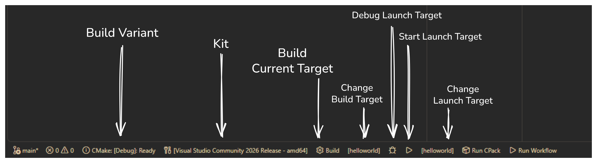

> [!NOTE]
> This is an excerpt of my personal notes that I've cleaned up a little for documenting my non-gamedev work and for sharing with others. -Terry

Using VS Code for something other than web development can be a challenge.
Whereas something like bonafide Visual Studio has a well-defined structure for
project configuration and build/debug operations, VS Code does not.

In this post, I'll walk through some of the approaches I have for working with
more traditional desktop-oriented projects:

- [C++](#c-cpp)

## Goals

Any programming language or environment I use with VS Code should ideally
support the following features:

1. **Language Server Protocol (LSP)** support for auto-complete/IntelliSense/code feedback
2. **Task Configuration** for triggering builds, executing tests
3. **Launch Configuration** for launching and debugging

Real-time programming feedback can be provided by any environment that
implementing a language server that VS Code can connect to. As you write code,
you can get usual error squiggles or auto-complete like as you would in a
dedicated IDE.

In lieu of a project configuration, we have **Tasks**, which encapsulate common
operations like building or debugging into things that can tie into the VS Code
interface almost as though support for something was built-in. Tasks can run
anything from VS Code commands to shell commands, allowing you to support just
about any environment with enough determination.

The ability to **generate configurations is preferred** over using specialized
commands for projects that follow the "write, build, run" paradigm. This favors
using the **same UX regardless of project type** instead of remembering
specific commands for specific types of projects. Configurations also offer a
rich set of properties in a consistent location.

### Warning: VS Code is Complicated

**Creating a new project in VS Code is complicated** as it requires
human intervention, may differ greatly between project types, and may automate
certain steps in some cases or not in others.

Users seeking a **turnkey experience** that allows them to hit "New Project" and
have something ready to work with should consider alternatives like Visual
Studio or JetBrains Rider.

## C++ (Cpp)

**CMake-based** projects are well supported by using a combination of the
[**C/C++** extension][VSextC/C++] and the [**CMake Tools** extension][VSextCMakeTools],
both maintained by Microsoft (the latter was originally created by
[vector-of-bools](https://github.com/vector-of-bool)).

You can create a CMake project directly from VS Code with the above extension by
running the "**CMake: Quick Start**" command to spawn a "Hello World" project.

Recommendations for a _write-debug-test_ setup:

1. [CMake Workflow (Configuration)](#cmake-workflow-configuration) :sparkles:
2. [CMake Workflow (Commands)](#cmake-workflow-commands)
3. [Manual Workflow](#manual-workflow)

> [!WARNING]
> CMake is a significant hurdle as it has its own language for describing your
> project on top of C++'s need for you to understand how the underlying build
> tools works (such as when prompted to select a compiler or kit for CMake).

CMake Tools also contributes some helpful UI elements that may be familiar to anyone
coming from full-fledged IDE:

The **Activity Bar** gets a "CMake" activity that lets you inspect project status, 
browse project files, or run pinned commands.

The **Status Bar** gets a variety of actions like building, debugging, selecting a
kit, or changing the project configuration.

<!--  -->

> [!NOTE]
> **Single file projects** are also somewhat well-supported and are
> introduced in the [quick start tutorials from Microsoft][VScppIntro] on C++ in
> VS Code. They focus on building and debugging by directly invoking the build
> tools and debugger through the task and launch configurations.
>
> I don't personally use it since my projects usually more complex than 1-2
> source files.

[VSextC/C++]:https://marketplace.visualstudio.com/items?itemName=ms-vscode.cpptools
[VSextCMakeTools]:https://github.com/microsoft/vscode-cmake-tools/blob/main/docs/README.md

[VScppIntro]:https://code.visualstudio.com/docs/cpp/introvideos-cpp
[CMakeTools]:https://github.com/microsoft/vscode-cmake-tools/blob/main/docs/README.md

### CMake Workflow (Configuration)

CMake projects can be built/run/debugged with task configurations that
invoke CMake Tools and launch configurations that are partially resolved by
CMake Tools.

- **Extensions**
	- [C/C++][VSextC/C++] from Microsoft
	- [CMake Tools][VSextCMakeTools] from Microsoft
- **Minimal Setup**
	1. Open a workspace that contains a CMakeLists.txt file
	2. Follow on-screen prompts (e.g., Select a kit, Select a Configure preset ...)
	3. _Wait for it to finish configuring_
	4. Run Command: "**Task: Configure Default Build Task**" and select "**CMake: build**" to generate a working tasks.json file
		- See [CMake Tools: Build with CMake Tools tasks][CMakeToolsTasks] for more information
	5. Create a **launch.json** and manually write a configuration for debugging your project
		- See [CMake Tools: Debug and launch/Debug using a launch.json file][CMakeToolsDebug] for examples for different debuggers

Sample `tasks.json` and `launch.json` provided respectively:

#### tasks.json

```jsonc
{
	"version": "2.0.0",
	"tasks": [
		{
			"type": "cmake",
			"label": "CMake: build",
			"command": "build",
			"targets": [
				"ALL_BUILD"
			],
			"group": {
				"kind": "build",
				"isDefault": true
			},
			"problemMatcher": [],
			"detail": "CMake template build task"
		}
	]
}
```

#### launch.json

```jsonc
{
    "version": "0.2.0",
    "configurations": [
        {
            "name": "(msvc) Launch",
            "type": "cppvsdbg",
            "request": "launch",
            // Resolved by CMake Tools:
            "program": "${command:cmake.launchTargetPath}",
            "args": [],
            "stopAtEntry": false,
            "cwd": "${workspaceFolder}",
            "environment": [
                {
                    // add the directory where our target was built to the PATHs
                    // it gets resolved by CMake Tools:
                    "name": "PATH",
                    "value": "${env:PATH}:${command:cmake.getLaunchTargetDirectory}"
                },
                {
                    "name": "OTHER_VALUE",
                    "value": "Something something"
                }
            ],
            "externalConsole": true
        }
    ]
}
```

> [!INFO]
> Creating a **launch.json** will **tie you to a specific debugger**, which can
> be unideal if you want a cross-platform launch configuration or want different
> debuggers on different platforms.

[CMakeToolsTasks]:https://github.com/microsoft/vscode-cmake-tools/blob/main/docs/tasks.md#build-with-cmake-tools-tasks
[CMakeToolsDebug]:https://github.com/microsoft/vscode-cmake-tools/blob/main/docs/debug-launch.md#debug-using-a-launchjson-file

### CMake Workflow (Commands)

CMake projects with CMakeLists.txt files can define targets that can be
built, launched, and debugged directly using CMake Tools' commands.

- **Extensions**
	- [C/C++][VSextC/C++] from Microsoft
	- [CMake Tools][VSextCMakeTools] from Microsoft
- **Minimal Setup**
	1. Open a workspace that contains a project with a populated CMakeLists.txt file
	2. Follow on-screen prompts (e.g., Select a kit, Select a Configure preset ...)
	3. _Wait for it to finish configuring_
	4. Run Command: "**CMake: Build**" can be used to build the current build target
	5. Run Command: "**CMake: Debug**" to build and debug the current debug target

### Manual Workflow

The [introduction tutorials from Microsoft on C++][VScppIntro] in VS Code focus
on building and debugging by directly invoking the build tools and debugger
through the task and launch configurations.

- **Extensions**
	- [C/C++][VSextC/C++] from Microsoft
- **Minimal Setup**
	1. Create a workspace
	2. Add and open a **Main.cpp** file in that workspace
	3. Run Command: "**C/C++: Debug C/C++ File**" to generate a working tasks.json file
		- You will be prompted to select your compiler.
	4. Run Command: "**C/C++: Add Debug Configuration**" to generate a working launch.json file
		- You will be prompted to select your compiler again; this should be the same as the last one you picked.

Additional properties for working with the debugger are available on VS Code's
page on [C++/Configure Debugging][VScppLaunch].

[VScppLaunch]:https://code.visualstudio.com/docs/cpp/launch-json-reference

#### CodeLLDB Workflow

See also [CodeLLDB][VSextCodeLLDB], a mature third-party debugger primarily for
C++ and Rust powered by LLDB. It has its own [extensive documentation][CodeLLDBMAN]
on its GitHub repository.

[VSextCodeLLDB]:https://marketplace.visualstudio.com/items?itemName=vadimcn.vscode-lldb
[CodeLLDBMAN]:https://github.com/vadimcn/codelldb/blob/master/MANUAL.md
